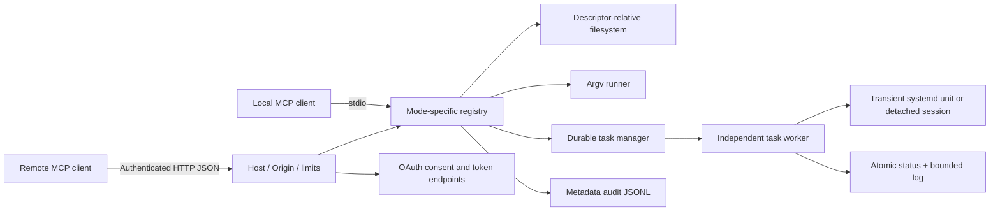

# Architecture

One CGO-free Go executable contains CLI, official MCP SDK server, HTTP host,
local authorization server and durable worker entry point. There is no resident
control-plane daemon. A task owns an independent worker only while that task
is running. HTTP `up` runs in the foreground until shutdown or idle expiry.

## Packages

| Package | Responsibility |
| --- | --- |
| identity | Temporary name, binary, module, version constants |
| config | Strict TOML, environment/CLI precedence, validation |
| policy | Modes, executable allow/deny, sudo preview |
| fsjail | Allowed-root handles, Linux openat2, Darwin os.Root, atomic replace |
| filesystem | Bounded directory listing and filename search |
| execrun | Argv/cwd/environment, bounded output, timeout/group cleanup |
| tasks | Worker specification/status, lifecycle, cursor logs and completion acknowledgments |
| auth | Private bearer token, OAuth registration, consent, PKCE, tokens, revocation |
| transport | SDK HTTP transport, authentication, limits, idle exit, local administration |
| tunnel | Owned outbound cloudflared process and Quick Tunnel URL parsing |
| audit | Cross-process locked append/rotation, metadata-only schema |
| platform | Durable atomic files, locks, process identity and process listing |
| mcpserver | Registry construction and handlers with audit/event attachment |

## Filesystem authority

Allowed roots are canonicalized only during setup, then pinned by directory
handles. Canonicalization is not the per-operation authorization mechanism.
Linux uses openat2 relative to pinned roots with RESOLVE_BENEATH,
RESOLVE_NO_SYMLINKS, RESOLVE_NO_MAGICLINKS and RESOLVE_NO_XDEV. O_PATH permits
inode validation before opening data. Only regular files/directories can be
reopened via the pinned `/proc/self/fd` entry. Existing-file write permission is
checked without truncation, and fresh-file data is synced and atomically
renamed inside a validated parent descriptor. Directory sync makes rename
persistence explicit. This avoids outside-target writes through link changes.
No claim is made to prevent another authorized local process modifying contents.

Dangerous mode pins `/` and uses RESOLVE_IN_ROOT with magic-link protection,
allowing ordinary symlinks and mount crossings while retaining supported-type
and size checks. macOS uses os.Root with nonblocking/no-follow final opens,
regular-file validation and descriptor-relative atomic replacement. Same-user
mount/device replacement is excluded on macOS; native verification is pending.

## Execution and task persistence

Commands require an absolute executable and explicit cwd. Cwd is held by a
validated descriptor while starting the child. No request environment or shell
string is interpreted. A fresh process group is created. Linux waitid WNOWAIT
and Darwin process-exit kqueue notification retain the group leader unreaped
until cancellation/cleanup signaling is done, preventing PID-group reuse.
Synchronous timeout defaults to 30 seconds and is capped at ten minutes.

Task start first durably writes spec/status. Linux launches the binary's private
worker entry point through `systemd-run --user --collect --service-type=exec`.
Fallback uses a detached new session. The worker independently revalidates
policy and roots, writes its identity, runs argv, logs at most 16 MiB, then
syncs output and atomically persists final status. It exits only after normal
completion handling; systemd collection therefore cannot erase normal results.
Stop is a private-file request to a live worker, not a signal to a stored PID.
Unexpected worker death/reboot is `lost`; command results cannot be reconstructed
if the worker dies before persistence. Tasks are not automatically resumed.

Completion records are persisted separately before final status, with a
monotonic sequence allocated under a cross-process lock. Status can recover from
the completion record if a worker exits between the two atomic writes. Per-client
acknowledged cursors are independent, locked, durable files. Forgetting task
metadata does not erase the event. Wall-clock rollback does not reorder cursors.
Live systemd cgroup metrics are sampled on status/list requests only; task_wait
does not repeatedly spawn metric queries. Detached live sampling is unavailable.

## HTTP and authorization

HTTP uses official SDK v1.8.0 StreamableHTTPHandler with Stateless and
JSONResponse. The SDK negotiates supported protocol versions; tests include
SDK-default negotiation and explicit 2025-11-25 requests. Older legacy SSE-only
transport is not implemented. A loopback listener and exact Host/Origin checks
remain active even with a tunnel; only its explicitly captured issuer hostname
is added. Reverse-proxy forwarding headers cannot change authority.

Local bearer and remote OAuth are distinct. OAuth grants exactly the configured
readonly/user scope for this MCP resource. A local human approves each grant
using a request-specific terminal code and cookie/CSRF-bound browser form.
Public and client_secret_basic confidential clients can dynamically register.
Authorization responses include RFC 9207 issuer identification; bearer
challenges include the required scope. Metadata does not
advertise client ID metadata documents or unimplemented auth methods.

State writes use fsync + rename, and cross-process audit/cursor operations use
flock. HTTP has one instance per state directory. OAuth state is held under its
HTTP instance ownership; a second instance cannot concurrently mutate it.
Tools audit intent before side effects and completion after. An audit write
failure refuses the operation; a post-side-effect audit failure is reported,
not rolled back. JSONL rotation is serialized across workers and transports.

## Verified reference versions

The [official SDK v1.8.0](https://github.com/modelcontextprotocol/go-sdk/tree/v1.8.0)
implements current MCP 2026-07-28 and older protocol compatibility. Transport,
authorization and annotations were checked against [Streamable HTTP](https://modelcontextprotocol.io/specification/2026-07-28/basic/transports/streamable-http),
[MCP authorization](https://modelcontextprotocol.io/specification/2026-07-28/basic/authorization)
and [tools](https://modelcontextprotocol.io/specification/2026-07-28/server/tools).
OAuth follows the authorization-code profile in the [OAuth 2.1 draft](https://datatracker.ietf.org/doc/html/draft-ietf-oauth-v2-1)
and [PKCE S256](https://www.rfc-editor.org/rfc/rfc7636).
The filesystem design follows [Go's traversal-resistant APIs](https://go.dev/blog/osroot)
with additional Linux openat2 restrictions. References are design inputs;
project test evidence is recorded separately in TEST_REPORT.md.
